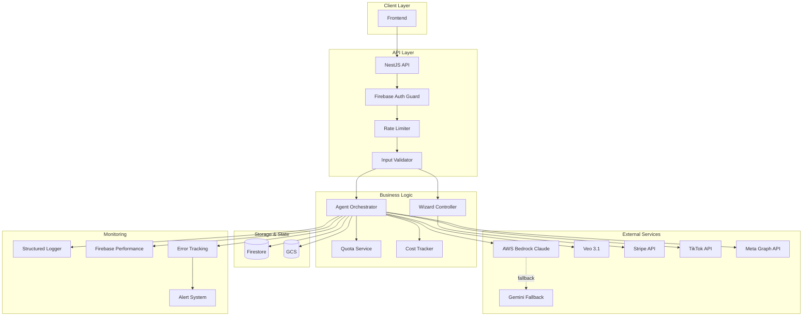
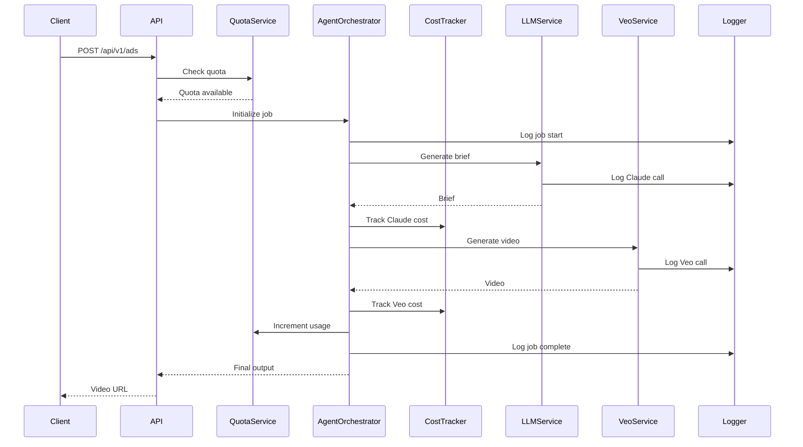

# Design Document: Backend Production Readiness

## Overview

This design transforms the MVP backend into a production-ready system by adding comprehensive monitoring, cost optimization, security hardening, payment integration, and social media publishing capabilities. The backend currently supports a complete AI video ad generation pipeline using NestJS, Firebase, Veo 3.1, AWS Bedrock Claude Sonnet 4.6 (with Gemini 2.5 Pro fallback), and Remotion.

### Current Architecture

The system consists of:
- **Agent Pipeline**: Multi-stage workflow (normalize → context → brief → scenarios → script → veo → subtitles → render)
- **LLM Service**: Unified service with Claude primary and Gemini fallback
- **Video Generation**: Veo 3.1 via Vertex AI
- **Storage**: GCS for assets and videos, Firestore for state
- **Rendering**: Remotion for final video composition

### Production Readiness Goals

1. **Observability**: Structured logging, metrics, and alerting
2. **Cost Management**: Per-job cost tracking and quota enforcement
3. **Security**: Input validation, signed URLs, rate limiting
4. **Monetization**: Stripe integration and promo codes
5. **Distribution**: TikTok and Meta publishing with scheduling
6. **Quality**: Integration, E2E, and load testing
7. **Operations**: Health checks, graceful shutdown, configuration management

## Architecture

### High-Level System Diagram



### Component Interaction Flow



## Components and Interfaces

### 1. Monitoring Module

#### StructuredLogger Service

```typescript
interface LogContext {
  correlationId: string;
  stage?: string;
  userId?: string;
  businessId?: string;
  jobId?: string;
  [key: string]: unknown;
}

interface LogEntry {
  timestamp: string;
  level: 'debug' | 'info' | 'warn' | 'error';
  message: string;
  context: LogContext;
  error?: {
    message: string;
    stack?: string;
    code?: string;
  };
}

class StructuredLogger {
  log(message: string, context: LogContext): void;
  error(message: string, error: Error, context: LogContext): void;
  logApiCall(service: string, operation: string, latency: number, context: LogContext): void;
  logFallback(from: string, to: string, reason: string, context: LogContext): void;
}
```

#### PerformanceMonitor Service

```typescript
interface PerformanceMetric {
  name: string;
  value: number;
  unit: 'ms' | 'count' | 'bytes';
  tags: Record<string, string>;
  timestamp: Date;
}

class PerformanceMonitor {
  trackLatency(operation: string, duration: number, tags?: Record<string, string>): void;
  trackCount(metric: string, value: number, tags?: Record<string, string>): void;
  startTimer(operation: string): () => void; // Returns stop function
  recordToFirebase(metrics: PerformanceMetric[]): Promise<void>;
}
```

### 2. Cost Tracking Module

#### CostTracker Service

```typescript
interface CostBreakdown {
  veoGeneration: number;
  claudeCalls: number;
  geminiCalls: number;
  totalCost: number;
  currency: 'USD';
}

interface ApiCallCost {
  service: 'veo' | 'claude' | 'gemini';
  operation: string;
  inputTokens?: number;
  outputTokens?: number;
  durationSeconds?: number;
  cost: number;
  timestamp: Date;
}

class CostTracker {
  calculateVeoCost(durationSec: number, quality: 'fast' | 'standard'): number;
  calculateClaudeCost(inputTokens: number, outputTokens: number): number;
  calculateGeminiCost(inputTokens: number, outputTokens: number): number;
  trackApiCall(jobId: string, call: ApiCallCost): Promise<void>;
  getJobCost(jobId: string): Promise<CostBreakdown>;
  getBusinessMonthlyCost(businessId: string): Promise<number>;
}
```

### 3. Quota Management Module

#### QuotaService

```typescript
interface SubscriptionTier {
  name: 'free' | 'starter' | 'pro' | 'enterprise';
  monthlyVideoLimit: number;
  concurrentJobLimit: number;
  features: string[];
}

interface UsageInfo {
  currentPeriodStart: Date;
  videosGenerated: number;
  videoLimit: number;
  activeJobs: number;
  jobLimit: number;
  remaining: number;
}

class QuotaService {
  checkQuota(businessId: string): Promise<UsageInfo>;
  canCreateJob(businessId: string): Promise<boolean>;
  incrementUsage(businessId: string): Promise<void>;
  resetMonthlyQuotas(): Promise<void>; // Scheduled function
  getSubscriptionTier(businessId: string): Promise<SubscriptionTier>;
}
```

#### RateLimiter Service

```typescript
interface RateLimitConfig {
  requestsPerMinute: number;
  concurrentJobs: number;
}

interface RateLimitResult {
  allowed: boolean;
  remaining: number;
  resetAt: Date;
  retryAfter?: number;
}

class RateLimiter {
  checkRateLimit(userId: string, businessId: string): Promise<RateLimitResult>;
  checkConcurrentJobs(businessId: string): Promise<RateLimitResult>;
  recordRequest(userId: string): Promise<void>;
  cleanupStaleEntries(): Promise<void>; // Scheduled function
}
```

### 4. Security Module

#### InputValidator Service

```typescript
interface ValidationResult {
  valid: boolean;
  errors: string[];
  sanitized?: unknown;
}

class InputValidator {
  validateCreateAdDto(dto: CreateAdDto): ValidationResult;
  sanitizeText(text: string): string;
  validateUrl(url: string): boolean;
  validateFileUpload(file: Express.Multer.File): ValidationResult;
}
```

#### SignedUrlService

```typescript
interface SignedUrlOptions {
  expiryMinutes: 15 | 60;
  action: 'read' | 'write';
}

class SignedUrlService {
  generateSignedUrl(gcsPath: string, options: SignedUrlOptions): Promise<string>;
  validateAccess(userId: string, businessId: string, resourcePath: string): Promise<boolean>;
  logUrlGeneration(userId: string, gcsPath: string): Promise<void>;
}
```

### 5. Payment Module

#### StripeService

```typescript
interface SubscriptionPlan {
  tier: 'starter' | 'pro' | 'enterprise';
  priceId: string;
  amount: number;
  currency: 'USD';
  interval: 'month' | 'year';
}

interface CheckoutSession {
  sessionId: string;
  url: string;
  expiresAt: Date;
}

class StripeService {
  createCheckoutSession(userId: string, planId: string, promoCode?: string): Promise<CheckoutSession>;
  createCustomer(userId: string, email: string): Promise<string>;
  handleWebhook(signature: string, payload: string): Promise<void>;
  cancelSubscription(subscriptionId: string): Promise<void>;
  getBillingPortalUrl(customerId: string): Promise<string>;
  validatePromoCode(code: string): Promise<boolean>;
}
```

### 6. Publishing Module

#### TikTokPublisher Service

```typescript
interface PublishRequest {
  videoGcsPath: string;
  caption: string;
  privacyLevel: 'public' | 'friends' | 'private';
  allowDuet: boolean;
  allowStitch: boolean;
}

interface PublishStatus {
  publishId: string;
  status: 'pending' | 'uploading' | 'published' | 'failed';
  platformPostId?: string;
  error?: string;
  publishedAt?: Date;
}

class TikTokPublisher {
  initiateOAuth(userId: string, redirectUri: string): Promise<string>;
  handleOAuthCallback(code: string, state: string): Promise<void>;
  publishVideo(userId: string, request: PublishRequest): Promise<PublishStatus>;
  getPublishStatus(publishId: string): Promise<PublishStatus>;
  refreshAccessToken(userId: string): Promise<void>;
}
```

#### MetaPublisher Service

```typescript
interface MetaPublishRequest {
  videoGcsPath: string;
  caption: string;
  platform: 'facebook' | 'instagram';
  pageId?: string; // For Facebook
  instagramAccountId?: string; // For Instagram
}

class MetaPublisher {
  initiateOAuth(userId: string, redirectUri: string): Promise<string>;
  handleOAuthCallback(code: string, state: string): Promise<void>;
  listPages(userId: string): Promise<Array<{id: string; name: string}>>;
  listInstagramAccounts(userId: string): Promise<Array<{id: string; username: string}>>;
  publishVideo(userId: string, request: MetaPublishRequest): Promise<PublishStatus>;
  getPublishStatus(publishId: string): Promise<PublishStatus>;
  refreshAccessToken(userId: string): Promise<void>;
}
```

#### SchedulerService

```typescript
interface ScheduledPost {
  id: string;
  projectId: string;
  platform: 'tiktok' | 'facebook' | 'instagram';
  scheduledTime: Date;
  status: 'scheduled' | 'publishing' | 'published' | 'failed' | 'canceled';
  publishRequest: PublishRequest | MetaPublishRequest;
  createdAt: Date;
}

class SchedulerService {
  schedulePost(userId: string, businessId: string, post: Omit<ScheduledPost, 'id' | 'status' | 'createdAt'>): Promise<string>;
  cancelScheduledPost(postId: string): Promise<void>;
  reschedulePost(postId: string, newTime: Date): Promise<void>;
  processScheduledPosts(): Promise<void>; // Cloud Function trigger
  getScheduledPosts(businessId: string): Promise<ScheduledPost[]>;
}
```

### 7. Health & Operations Module

#### HealthCheckService

```typescript
interface HealthStatus {
  status: 'healthy' | 'degraded' | 'unhealthy';
  checks: {
    firestore: boolean;
    gcs: boolean;
    vertexAi: boolean;
    bedrock: boolean;
  };
  timestamp: Date;
}

class HealthCheckService {
  checkHealth(): Promise<HealthStatus>;
  checkReadiness(): Promise<HealthStatus>;
  checkFirestore(): Promise<boolean>;
  checkGCS(): Promise<boolean>;
  checkVertexAI(): Promise<boolean>;
  checkBedrock(): Promise<boolean>;
}
```

#### ConfigService Extensions

```typescript
interface EnvironmentConfig {
  environment: 'development' | 'staging' | 'production';
  apiVersion: string;
  features: {
    tiktokPublishing: boolean;
    metaPublishing: boolean;
    scheduling: boolean;
  };
}

class ConfigManager {
  loadFromSecretManager(secretName: string): Promise<string>;
  validateRequiredConfig(): void;
  getEnvironmentConfig(): EnvironmentConfig;
}
```

## Data Models

### Extended Firestore Schema

#### businesses/{bizId}/agent_jobs/{jobId}

```typescript
interface AgentJobDocument {
  // ... existing fields ...
  
  // Cost tracking
  costBreakdown?: {
    veoGeneration: number;
    claudeCalls: number;
    geminiCalls: number;
    totalCost: number;
    currency: 'USD';
  };
  
  // API call details
  apiCalls?: Array<{
    service: 'veo' | 'claude' | 'gemini';
    operation: string;
    inputTokens?: number;
    outputTokens?: number;
    durationSeconds?: number;
    cost: number;
    timestamp: Date;
  }>;
  
  // LLM provider tracking
  llmProvider?: 'claude' | 'gemini'; // Which provider was used
  fallbackTriggered?: boolean; // Whether fallback occurred
  
  // Monitoring
  correlationId: string;
  performanceMetrics?: {
    totalDuration: number;
    stageDurations: Record<string, number>;
  };
}
```

#### businesses/{bizId}

```typescript
interface BusinessDocument {
  // ... existing fields ...
  
  // Usage tracking
  usage: {
    adsGeneratedThisMonth: number;
    adsGeneratedTotal: number;
    currentPeriodStart: Date;
    activeJobs: number; // For concurrent limit
  };
  
  // Subscription
  subscription: {
    tier: 'free' | 'starter' | 'pro' | 'enterprise';
    status: 'active' | 'canceled' | 'past_due' | 'trialing';
    stripeCustomerId?: string;
    stripeSubscriptionId?: string;
    currentPeriodStart?: Date;
    currentPeriodEnd?: Date;
    customVideoLimit?: number; // For enterprise
  };
  
  // Cost tracking
  monthlyCosts?: {
    [yearMonth: string]: number; // e.g., "2025-01": 123.45
  };
}
```

#### users/{uid}

```typescript
interface UserDocument {
  // ... existing fields ...
  
  // Social platform connections
  socialConnections?: {
    tiktok?: {
      accessToken: string; // Encrypted
      refreshToken: string; // Encrypted
      expiresAt: Date;
      username: string;
    };
    meta?: {
      accessToken: string; // Encrypted
      refreshToken: string; // Encrypted
      expiresAt: Date;
      userId: string;
    };
  };
  
  // Rate limiting
  rateLimitState?: {
    requestCount: number;
    windowStart: Date;
  };
}
```

#### scheduled_posts/{postId}

```typescript
interface ScheduledPostDocument {
  id: string;
  userId: string;
  businessId: string;
  projectId: string;
  platform: 'tiktok' | 'facebook' | 'instagram';
  scheduledTime: Date;
  status: 'scheduled' | 'publishing' | 'published' | 'failed' | 'canceled';
  publishRequest: {
    videoGcsPath: string;
    caption: string;
    // Platform-specific fields
  };
  publishResult?: {
    platformPostId?: string;
    error?: string;
    publishedAt?: Date;
  };
  createdAt: Date;
  updatedAt: Date;
}
```

#### promo_codes/{codeId}

```typescript
interface PromoCodeDocument {
  code: string;
  stripePromotionId: string;
  discountType: 'percentage' | 'fixed' | 'trial_extension';
  discountValue: number;
  maxRedemptions?: number;
  redemptionCount: number;
  expiresAt?: Date;
  active: boolean;
  createdAt: Date;
}
```

## Error Handling

### Error Classification

```typescript
enum ErrorSeverity {
  CRITICAL = 'critical', // System down
  HIGH = 'high',         // Feature broken
  MEDIUM = 'medium',     // Degraded performance
  LOW = 'low'            // Minor issue
}

interface AppError {
  code: string;
  message: string;
  severity: ErrorSeverity;
  context: Record<string, unknown>;
  timestamp: Date;
  correlationId: string;
}
```

### Error Handling Strategy

1. **Quota Exceeded**: Return 429 with clear message and reset time
2. **Rate Limit**: Return 429 with retry-after header
3. **Payment Failed**: Return 402 with billing portal URL
4. **Invalid Input**: Return 400 with validation errors
5. **Auth Failed**: Return 401 with clear message
6. **Permission Denied**: Return 403 with resource info
7. **External API Failure**: Retry with exponential backoff, fallback if available
8. **Internal Error**: Return 500, log full context, alert if critical

### Alert Triggers

- Critical: System cannot start, all external APIs down
- High: Veo API down, payment processing failed, >10% error rate
- Medium: Fallback triggered >50% of time, quota reset failed
- Low: Individual job failures, validation errors

## Testing Strategy

### Unit Tests

Focus on business logic in isolation:
- QuotaService: Quota calculations, usage tracking
- CostTracker: Cost calculations for each provider
- RateLimiter: Rate limit logic, concurrent job checks
- InputValidator: Validation rules, sanitization
- StripeService: Webhook handling, subscription logic

### Integration Tests

Test full pipeline with real services in test environment:
- Complete wizard flow: brief → script → scene → video
- Cost tracking: Verify costs recorded for each API call
- Quota enforcement: Create jobs until limit, verify rejection
- LLM fallback: Simulate Claude failure, verify Gemini fallback
- Publishing: Mock TikTok/Meta APIs, verify request format

### E2E Tests

Test critical user workflows:
- User registration → subscription → video generation → retrieval
- Wizard flow → job submission → polling → final video
- Quota exceeded → upgrade subscription → retry
- Schedule post → wait for trigger → verify published
- Apply promo code → create subscription → verify discount

### Load Tests

Simulate production load:
- 50 concurrent video generation jobs
- Measure: latency, throughput, error rate, resource usage
- Verify: rate limiting works, queue handles backpressure
- Identify: bottlenecks, timeout thresholds, scaling limits

### Test Environment Setup

```yaml
test_environment:
  firebase_project: "phanes-test"
  gcs_bucket: "phanes-test-storage"
  firestore: "test-db"
  vertex_ai: "us-central1"
  stripe: "test mode"
  external_apis: "mocked"
```

## API Specifications

### Monitoring Endpoints

```
GET /api/v1/health
Response: { status: "healthy", checks: {...}, timestamp: "..." }

GET /api/v1/ready
Response: { status: "ready", checks: {...}, timestamp: "..." }

GET /api/v1/metrics (authenticated, admin only)
Response: Prometheus-compatible metrics

GET /api/v1/config (authenticated, admin only)
Response: { environment: "...", apiVersion: "...", features: {...} }
```

### Cost & Usage Endpoints

```
GET /api/v1/businesses/:businessId/usage
Response: {
  currentPeriodStart: "...",
  videosGenerated: 5,
  videoLimit: 20,
  remaining: 15,
  activeJobs: 2,
  jobLimit: 3
}

GET /api/v1/businesses/:businessId/costs
Query: ?month=2025-01
Response: {
  totalCost: 123.45,
  breakdown: { veo: 100, claude: 20, gemini: 3.45 },
  currency: "USD"
}

GET /api/v1/projects/:projectId/cost
Response: {
  totalCost: 5.67,
  breakdown: { veo: 4.80, claude: 0.87, gemini: 0 },
  apiCalls: [...]
}
```

### Payment Endpoints

```
POST /api/v1/subscriptions/checkout
Body: { planId: "starter", promoCode?: "BETA50" }
Response: { sessionId: "...", url: "https://checkout.stripe.com/..." }

POST /api/v1/subscriptions/cancel
Response: { success: true, endsAt: "..." }

GET /api/v1/subscriptions/portal
Response: { url: "https://billing.stripe.com/..." }

POST /api/v1/webhooks/stripe
Headers: { stripe-signature: "..." }
Body: Stripe event payload
Response: { received: true }

POST /api/v1/promo-codes/validate
Body: { code: "BETA50" }
Response: { valid: true, discount: { type: "percentage", value: 50 } }
```

### Publishing Endpoints

```
GET /api/v1/publishing/tiktok/auth
Query: ?redirectUri=...
Response: { authUrl: "https://www.tiktok.com/auth/..." }

POST /api/v1/publishing/tiktok/callback
Body: { code: "...", state: "..." }
Response: { success: true }

POST /api/v1/publishing/tiktok/publish
Body: {
  projectId: "...",
  caption: "...",
  privacyLevel: "public",
  allowDuet: true,
  allowStitch: true
}
Response: { publishId: "...", status: "pending" }

GET /api/v1/publishing/:publishId/status
Response: {
  publishId: "...",
  status: "published",
  platformPostId: "...",
  publishedAt: "..."
}

# Similar endpoints for Meta (Facebook/Instagram)
GET /api/v1/publishing/meta/auth
POST /api/v1/publishing/meta/callback
GET /api/v1/publishing/meta/pages
GET /api/v1/publishing/meta/instagram-accounts
POST /api/v1/publishing/meta/publish

# Scheduling
POST /api/v1/scheduled-posts
Body: {
  projectId: "...",
  platform: "tiktok",
  scheduledTime: "2025-02-01T10:00:00Z",
  publishRequest: {...}
}
Response: { postId: "...", status: "scheduled" }

GET /api/v1/scheduled-posts
Query: ?businessId=...
Response: { posts: [...] }

DELETE /api/v1/scheduled-posts/:postId
Response: { success: true }

PATCH /api/v1/scheduled-posts/:postId
Body: { scheduledTime: "2025-02-02T10:00:00Z" }
Response: { success: true }
```

## Implementation Plan

### Phase 1: Monitoring & Observability (Week 1)
- Implement StructuredLogger with correlation IDs
- Add Firebase Performance Monitoring integration
- Create PerformanceMonitor service
- Add logging to all agent stages
- Implement error tracking and alerting

### Phase 2: Cost & Quota Management (Week 2)
- Implement CostTracker service
- Add cost calculation for Veo, Claude, Gemini
- Implement QuotaService with tier-based limits
- Add RateLimiter with Firestore-based tracking
- Create scheduled functions for quota reset and cleanup

### Phase 3: Security Hardening (Week 3)
- Implement InputValidator with class-validator
- Add SignedUrlService with short expiry
- Configure CORS for production
- Add file upload validation
- Implement audit logging for sensitive operations

### Phase 4: Payment Integration (Week 4)
- Integrate Stripe SDK
- Implement StripeService with webhook handling
- Create checkout and portal endpoints
- Add promo code support
- Test subscription lifecycle

### Phase 5: Social Publishing (Week 5-6)
- Implement TikTokPublisher with OAuth
- Implement MetaPublisher with OAuth
- Add token encryption and refresh logic
- Create SchedulerService with Cloud Functions trigger
- Test publishing workflows

### Phase 6: Testing & Documentation (Week 7)
- Write integration tests for full pipeline
- Write E2E tests for critical paths
- Conduct load testing
- Update documentation
- Create runbooks for operations

### Phase 7: Health & Operations (Week 8)
- Implement HealthCheckService
- Add graceful shutdown handling
- Configure environment-based config
- Add API versioning
- Deploy to staging and production

## Security Considerations

### Authentication & Authorization
- All endpoints require Firebase Auth token
- Business-level authorization checks
- Admin-only endpoints for monitoring and config

### Data Protection
- Encrypt social platform tokens at rest
- Use Google Secret Manager for sensitive config
- Short-lived signed URLs (15min-1hr)
- Audit logging for all data access

### Input Validation
- Validate all DTO fields with class-validator
- Sanitize text inputs to prevent XSS
- Validate file types and sizes
- Rate limit all endpoints

### API Security
- CORS whitelist for production
- Stripe webhook signature validation
- OAuth state parameter validation
- HTTPS only in production

## Performance Considerations

### Latency Targets
- Health check: <100ms
- Quota check: <200ms
- Cost calculation: <500ms
- Signed URL generation: <500ms
- API request: <5s (excluding video generation)

### Scalability
- Firestore handles 10k+ concurrent reads
- GCS handles unlimited storage
- Rate limiting prevents abuse
- Concurrent job limits prevent overload

### Optimization Strategies
- Cache subscription tier lookups
- Batch Firestore writes where possible
- Use Firestore transactions for quota checks
- Lazy-load cost calculations
- Index Firestore queries for performance

## Deployment Strategy

### Environment Configuration

```yaml
development:
  firebase_project: "phanes-dev"
  gcs_bucket: "phanes-dev-storage"
  stripe_mode: "test"
  log_level: "debug"

staging:
  firebase_project: "phanes-staging"
  gcs_bucket: "phanes-staging-storage"
  stripe_mode: "test"
  log_level: "info"

production:
  firebase_project: "phanes-prod"
  gcs_bucket: "phanes-prod-storage"
  stripe_mode: "live"
  log_level: "warn"
```

### Deployment Steps

1. Run all tests (unit, integration, E2E)
2. Build Docker image
3. Deploy to staging
4. Run smoke tests
5. Monitor for 24 hours
6. Deploy to production with canary (10% traffic)
7. Monitor metrics and errors
8. Gradually increase traffic to 100%
9. Keep previous version for quick rollback

### Rollback Plan

- Keep previous 3 versions deployed
- Monitor error rate and latency
- Automatic rollback if error rate >5%
- Manual rollback command available
- Database migrations are backward compatible

## Monitoring & Alerting

### Key Metrics

- Request latency (p50, p95, p99)
- Error rate by endpoint and stage
- LLM success rate (Claude vs Gemini)
- Veo generation time
- Cost per job
- Quota utilization
- Active jobs count
- Publishing success rate

### Alert Rules

```yaml
critical_alerts:
  - system_down: error_rate > 50% for 5min
  - all_apis_down: external_api_failures > 90% for 5min
  
high_alerts:
  - veo_api_down: veo_failures > 80% for 10min
  - payment_failures: stripe_webhook_failures > 10 for 5min
  - high_error_rate: error_rate > 10% for 15min
  
medium_alerts:
  - high_fallback_rate: gemini_fallback_rate > 50% for 30min
  - quota_reset_failed: quota_reset_errors > 0
  
low_alerts:
  - individual_job_failure: job_status = failed
  - validation_errors: validation_error_rate > 5% for 1hr
```

### Dashboards

1. **System Health**: Overall status, error rates, latency
2. **Cost Analytics**: Daily/monthly costs, cost per job, provider breakdown
3. **Usage Metrics**: Videos generated, quota utilization, active users
4. **LLM Performance**: Claude vs Gemini usage, fallback rate, token usage
5. **Publishing**: Success rate by platform, scheduled posts, failures

## Documentation Requirements

### API Documentation
- OpenAPI/Swagger spec for all endpoints
- Authentication requirements
- Rate limit information
- Example requests and responses
- Error codes and meanings

### Operational Runbooks
- Deployment procedures
- Rollback procedures
- Incident response playbook
- Quota reset procedures
- Cost optimization guide

### Developer Documentation
- Architecture overview
- Component interaction diagrams
- Database schema
- Configuration guide
- Testing guide

---

**Design Status**: Ready for implementation
**Last Updated**: 2025-01-XX
**Version**: 1.0
