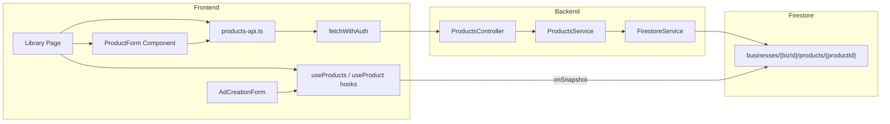
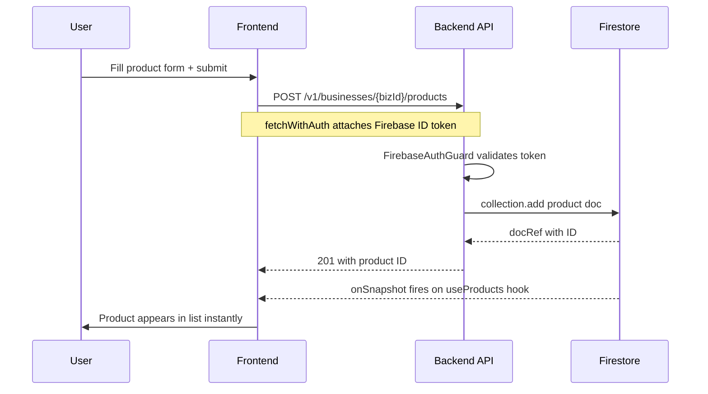
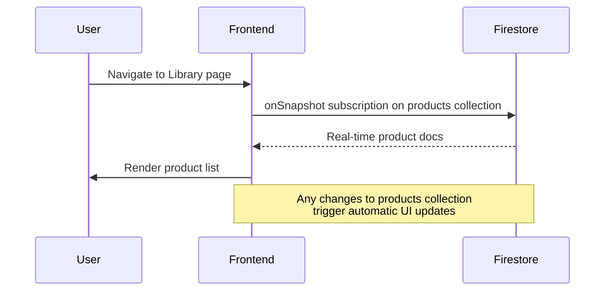

# Products CRUD — Implementation Plan

**Date:** 2026-03-27
**Scope:** Full-stack Products CRUD for the Library page

---

## Architecture Overview



**Pattern:** Reads use direct Firestore `onSnapshot` subscriptions from the frontend (real-time). Writes go through the backend REST API via `fetchWithAuth` (server-side validation + auth guard).

---

## 1. Firestore Document Shape

Path: `businesses/{bizId}/products/{productId}`

Matches `firestore_schema.md` Section 4:

```typescript
interface Product {
  id: string; // Auto-generated document ID
  businessId: string; // Parent business reference
  name: string; // Product name (required)
  description?: string; // Product description
  benefits?: string[]; // Key product benefits
  urls?: string[]; // Product page URLs
  brandAssets?: {
    // Uploaded brand/product assets
    storageKey: string; // GCS path
    type: "image" | "video" | "logo";
    filename: string; // Original filename
  }[];
  defaults?: {
    // Product-specific ad defaults
    tone?: string;
    targetAudience?: string;
    language?: string;
    cta?: string;
  };
  createdAt: Timestamp;
  updatedAt: Timestamp;
  deletedAt?: Timestamp; // Soft delete marker
}
```

---

## 2. Backend Implementation

### 2.1 File Structure

```
backend/src/products/
├── products.module.ts
├── products.controller.ts
├── products.service.ts
└── dto/
    ├── create-product.dto.ts
    └── update-product.dto.ts
```

### 2.2 DTOs

**`create-product.dto.ts`**

```typescript
import {
  IsString,
  IsOptional,
  IsArray,
  ValidateNested,
  IsEnum,
} from "class-validator";
import { Type } from "class-transformer";

class ProductDefaultsDto {
  @IsOptional() @IsString() tone?: string;
  @IsOptional() @IsString() targetAudience?: string;
  @IsOptional() @IsString() language?: string;
  @IsOptional() @IsString() cta?: string;
}

export class CreateProductDto {
  @IsString() name: string;
  @IsOptional() @IsString() description?: string;
  @IsOptional() @IsArray() @IsString({ each: true }) benefits?: string[];
  @IsOptional() @IsArray() @IsString({ each: true }) urls?: string[];
  @IsOptional()
  @ValidateNested()
  @Type(() => ProductDefaultsDto)
  defaults?: ProductDefaultsDto;
}
```

**`update-product.dto.ts`** extends `PartialType(CreateProductDto)`.

### 2.3 ProductsService

```
ProductsService (injected: FirestoreService)
├── create(businessId, createdBy, dto)  → string (new productId)
├── findAll(businessId)                 → Product[]
├── findOne(businessId, productId)      → Product
├── update(businessId, productId, dto)  → void
├── softDelete(businessId, productId)   → void
```

**Collection path:** `businesses/${businessId}/products`

All methods use the existing `FirestoreService` helpers:

- `create` → `firestore.collection(...).add({...dto, businessId, createdAt, updatedAt})`
- `findAll` → `firestore.collection(...).where('deletedAt', '==', null).orderBy('createdAt', 'desc').get()`
- `findOne` → `firestore.doc(...).get()`
- `update` → `firestore.doc(...).update({...dto, updatedAt})`
- `softDelete` → `firestore.doc(...).update({ deletedAt: serverTimestamp() })`

### 2.4 ProductsController

```
@Controller('v1/businesses/:businessId/products')
@UseGuards(FirebaseAuthGuard)
```

| Method   | Route         | Handler                                                  | Auth              |
| -------- | ------------- | -------------------------------------------------------- | ----------------- |
| `POST`   | `/`           | `create(@Param businessId, @Body dto, @GetUser user)`    | FirebaseAuthGuard |
| `GET`    | `/`           | `findAll(@Param businessId)`                             | FirebaseAuthGuard |
| `GET`    | `/:productId` | `findOne(@Param businessId, @Param productId)`           | FirebaseAuthGuard |
| `PATCH`  | `/:productId` | `update(@Param businessId, @Param productId, @Body dto)` | FirebaseAuthGuard |
| `DELETE` | `/:productId` | `softDelete(@Param businessId, @Param productId)`        | FirebaseAuthGuard |

**Note:** Uses the existing `FirebaseAuthGuard` and `@GetUser()` decorator from `backend/src/auth/`. The guard verifies the Firebase ID token. Business membership checking can be added later (or via Firestore security rules for direct reads).

### 2.5 ProductsModule

```typescript
@Module({
  imports: [AuthModule],
  controllers: [ProductsController],
  providers: [ProductsService],
  exports: [ProductsService],
})
export class ProductsModule {}
```

Register in `app.module.ts` alongside `UsersModule` and `AdsModule`.

---

## 3. Frontend Implementation

### 3.1 File Structure

```
frontend/src/lib/firebase/hooks.ts         → add useProducts(), useProduct()
frontend/src/lib/products-api.ts           → new file: REST API functions
frontend/src/components/forms/ProductForm.tsx  → new file: create/edit form
frontend/src/app/[locale]/library/page.tsx → refactor to use real data
frontend/src/components/forms/AdCreationForm.tsx → add product picker
```

### 3.2 Real-time Hooks (hooks.ts additions)

**`useProducts(businessId)`** — follows exact pattern of existing `useProjects()`:

```typescript
// Subscribe to businesses/{bizId}/products where deletedAt == null, ordered by createdAt desc
// Returns { products: ProductData[], loading: boolean, error: Error | null }
```

**`useProduct(businessId, productId)`** — follows exact pattern of existing `useProject()`:

```typescript
// Subscribe to businesses/{bizId}/products/{productId}
// Returns { product: ProductData | null, loading: boolean, error: Error | null }
```

**`ProductData` interface:**

```typescript
export interface ProductData extends DocumentData {
  id: string;
  businessId: string;
  name: string;
  description?: string;
  benefits?: string[];
  urls?: string[];
  brandAssets?: { storageKey: string; type: string; filename: string }[];
  defaults?: {
    tone?: string;
    targetAudience?: string;
    language?: string;
    cta?: string;
  };
  createdAt: Timestamp;
  updatedAt: Timestamp;
  deletedAt?: Timestamp;
}
```

### 3.3 Products API Functions (products-api.ts)

Uses `fetchWithAuth` from `api-client.ts`:

```typescript
export async function createProduct(
  businessId: string,
  data: CreateProductPayload,
): Promise<{ id: string }>;
export async function updateProduct(
  businessId: string,
  productId: string,
  data: UpdateProductPayload,
): Promise<void>;
export async function deleteProduct(
  businessId: string,
  productId: string,
): Promise<void>;
```

Base URL pattern: `/v1/businesses/${businessId}/products`

### 3.4 ProductForm Component

A form component used for both creating and editing products.

**Fields:**

- `name` (required, text input)
- `description` (optional, textarea)
- `benefits` (optional, tag/chip input — add items to array)
- `urls` (optional, repeatable URL input)
- `defaults.tone` (optional, select: direct/playful/professional/etc.)
- `defaults.targetAudience` (optional, text input)
- `defaults.language` (optional, select: en/de)
- `defaults.cta` (optional, text input)

**Behavior:**

- In create mode: calls `createProduct()`, on success the `useProducts()` hook auto-updates the list.
- In edit mode: calls `updateProduct()`, same live-update behavior.
- Could be inline in the Library page or a modal/dialog.

### 3.5 Library Page Refactor

**Changes to `frontend/src/app/[locale]/library/page.tsx`:**

1. Import `useAuth` to get `platformContext.account_id` (businessId).
2. Import and use `useProducts(businessId)` instead of `MOCK_PRODUCTS`.
3. Replace the product selector dropdown to iterate over real products.
4. Add a "Create Product" button that opens the `ProductForm` component.
5. In the "Text information" section: bind inputs to the selected product's real data and call `updateProduct()` on form submit/blur.
6. Handle loading and empty states.

### 3.6 AdCreationForm Product Picker

**Changes to `frontend/src/components/forms/AdCreationForm.tsx`:**

1. Import `useProducts(businessId)` hook.
2. Add a product selector dropdown before or alongside the prompt input.
3. When a product is selected, auto-populate `product_info` fields in the form.
4. Pass the selected `productId` in the `AdJobRequest` payload (already has `productId` field).

---

## 4. Data Flow Diagrams

### Create Product Flow



### Read Products Flow



---

## 5. Implementation Order

| Step | Area     | Description                                                            |
| ---- | -------- | ---------------------------------------------------------------------- |
| 1    | Backend  | Create `dto/create-product.dto.ts` and `dto/update-product.dto.ts`     |
| 2    | Backend  | Create `products.service.ts` with CRUD methods                         |
| 3    | Backend  | Create `products.controller.ts` with REST endpoints                    |
| 4    | Backend  | Create `products.module.ts` and register in `app.module.ts`            |
| 5    | Frontend | Add `ProductData` interface and `useProducts()` / `useProduct()` hooks |
| 6    | Frontend | Create `products-api.ts` with write functions                          |
| 7    | Frontend | Create `ProductForm.tsx` component                                     |
| 8    | Frontend | Refactor Library page to use real data and integrate ProductForm       |
| 9    | Frontend | Add product picker to AdCreationForm                                   |

---

## 6. Notes & Decisions

- **No Next.js API route proxy needed for products.** The existing proxy pattern in `frontend/src/app/api/ads/` was created before `fetchWithAuth` existed. The `fetchWithAuth` utility in `api-client.ts` calls the backend directly with auth headers, which is the preferred pattern going forward.
- **Soft delete only.** The `DELETE` endpoint sets `deletedAt` timestamp, never hard-deletes. The `useProducts()` hook filters with `where('deletedAt', '==', null)`.
- **Brand assets upload** is deferred — the `brandAssets` field is in the schema but file upload (signed URL generation, GCS upload) is a separate feature. The form can include the field structure but the upload UX will be a follow-up.
- **Validation** uses `class-validator` on the backend (matching existing patterns in the NestJS codebase). The frontend relies on zod for form validation.
- **Business membership authorization** — for MVP, the `FirebaseAuthGuard` (token verification) is sufficient. Fine-grained membership checks (is the user a member of this business?) can be added as a follow-up middleware or handled by Firestore security rules for direct reads.
